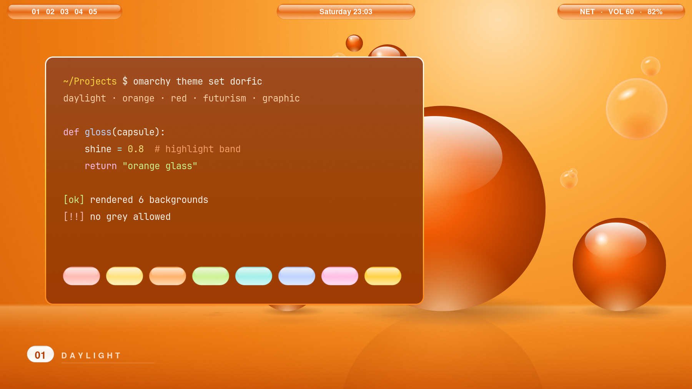

# DORFic

An orange-glass theme for [Omarchy](https://omarchy.org) 4 (Quattro) after **DORFic**,
the fan-catalogued aesthetic of 2000s–2010s clean corporate futurism. The name is an
acronym (**D**aylight, **O**range, **R**ed, **F**uturism, plus the "-ic" of graph**ic**)
coined on the Aesthetics Wiki in April 2023: white test chambers and one loud orange,
glossy console blades, white-and-orange phones, sunlit glass.

This theme leans orange: ember-orange surfaces that turn into tinted glass over Hyprland
blur, a white → gold → orange glossy frame, fat rounded corners and soft ember shadows.



## Install

```bash
omarchy theme install https://github.com/LizinDev/omarchy-dorfic-theme.git
```

For the glossy bar capsules, also install [Gloss Bar](https://github.com/LizinDev/omarchy-gloss-bar),
a zero-width bar widget that draws them under the stock bar (it draws nothing under themes
without a `[gloss-bar]` section). The bar strip is clear in this theme, so use
`omarchy bar transparent false` to keep the white bar text.

## Palette

| Role | Hex | |
|---|---|---|
| background | `#8f3000` | ember: terminals, menus, popups (80% / ~75% opaque) |
| foreground | `#fff3e6` | cream text, 7.42:1 on background |
| accent | `#ffd23f` | sunlight gold: borders, selection, shortcuts |
| selection | `#c4520c` | text selection |
| muted | `#f2a066` | comments, ANSI bright-black |

ANSI colors are pastel tints (`#ffb8ae` red · `#c9f28f` green · `#ffe27a` yellow ·
`#bcd2ff` blue · `#ffbce6` magenta · `#9ff0ea` cyan) so every hue stays readable on
orange. Passes the Omarchy palette validator in `--strict`.

## What's here

| File | |
|---|---|
| `colors.toml` | the palette; Omarchy generates every other app's config from it |
| `hyprland.lua` | rounding 18, white-gold-orange gradient border, ember shadow, blur on windows and shell layers |
| `kitty.conf`, `alacritty.toml`, `ghostty.conf` | the stock templates rendered with this palette, plus 0.8 background opacity |
| `shell.*.toml` | glass cards (menu, launcher, popups, notifications, lock), white selected pill, clear 34 px bar with white text |
| `shell.gloss-bar.toml` | translucent orange capsules for the Gloss Bar plugin |
| `backgrounds/` | six backgrounds drawn from code (bubbles, blades, hexcells, panels, ribbons, capsule) |

## Regenerating

```bash
python3 -I tools/wallpapers.py          # backgrounds (add names to render a subset, --scale 0.5 to draft)
python3 -I tools/terminals.py           # terminal configs, after a palette change
omarchy theme set dorfic && python3 tools/shell-overrides.py && omarchy theme refresh
python3 -I tools/preview.py             # preview.png
```

The section overrides restate every generated key as frozen hex, so re-run
`shell-overrides.py` after any change to `colors.toml`.

## License

MIT. Every image in this repo is generated by the scripts in `tools/`.
